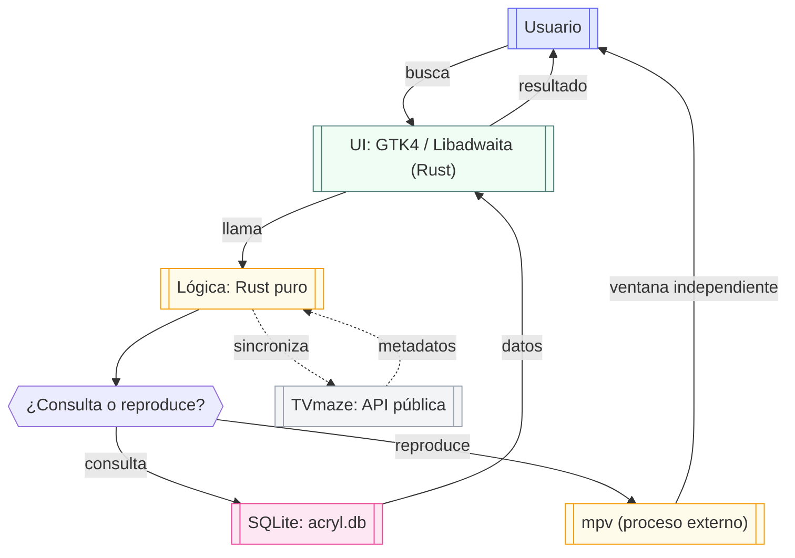

<p align="center">
  
</p>

<h1 align="center">Acryl</h1>

<p align="center">
  <strong>Gestor de contenido multimedia de escritorio para Linux</strong><br/>
  Indexa tu colección de películas, series y anime en una base de datos SQLite local<br/>
  y reproduce tus episodios con mpv, el reproductor de referencia en Linux.
</p>

<p align="center">
  <a href="https://github.com/Angel-p-v/app-media-manager/actions/workflows/ci.yml">
    
  </a>
  <a href="https://github.com/Angel-p-v/app-media-manager/blob/main/LICENSE">
    
  </a>
  <a href="https://www.rust-lang.org/">
    
  </a>
  <a href="https://gtk.org/">
    
  </a>
</p>

---

## 🎯 ¿Qué es Acryl?

**Acryl** es una aplicación de escritorio nativa para Linux que te permite indexar, buscar y reproducir tu colección local de películas, series y anime. La interfaz es Rust + GTK4/Libadwaita y la reproducción se delega a `mpv` en una ventana independiente.

Todo se ejecuta localmente en tu máquina: la base de datos SQLite, el índice de búsqueda de texto completo (FTS5) y la integración con `mpv` mediante `std::process::Command`.

---

## ✨ Características principales

| Capacidad | Descripción |
|-----------|-------------|
| 📚 **Biblioteca local** | Indexa películas, series y anime en una base de datos SQLite con búsqueda FTS5 |
| 🔍 **Búsqueda rápida** | Busca por título con filtrado por tipo y paginación |
| 🏷️ **Categorías** | Filtra la biblioteca por géneros/etiquetas obtenidos de los metadatos (TVmaze) |
| 🖼️ **Pósteres, banners y metadatos** | Descarga pósteres, sinopsis y puntuación (vote_average) desde TVmaze; banners anchos desde TVmaze/AniList. Imágenes individuales por episodio. |
| ▶️ **Reproducción con mpv** | Abre el episodio seleccionado en `mpv` en pantalla completa (ventana independiente) |
| ⚙️ **Configuración YAML** | Ajustes persistentes en archivo YAML (idioma, ruta de base de datos, reproductor predeterminado) |
| 🌐 **Idiomas** | Interfaz disponible en español e inglés |
| 📦 **Instalación** | Clona el repositorio y ejecuta `./scripts/install.sh` |

---

## 🏗️ Arquitectura

media-manager (Acryl) sigue una arquitectura de capas separadas que garantiza mantenibilidad, pruebas y seguridad:



### Flujo de datos

1. El usuario busca o navega por medios en la UI (GTK4 / Libadwaita, Rust).
2. La UI llama directamente a funciones Rust del backend.
3. El backend consulta **una única base de datos SQLite** (`acryl.db`) y devuelve los resultados a la UI.
4. Para la reproducción, el backend lanza `mpv` como proceso externo (`std::process::Command`) en su propia ventana; `mpv` gestiona play, pausa, seek, volumen y pistas.
5. Los metadatos se sincronizan en segundo plano con TVmaze (API pública, sin API key) para obtener pósteres y sinopsis automáticamente. Para el banner ancho de la vista de detalles se consultan las imágenes `background`/`banner` de TVmaze y, en anime, el banner de AniList (con Kitsu como respaldo). Desde Ajustes se puede forzar una actualización completa que sobrescribe los metadatos de todos los medios indexados.

### Principios de diseño

- **Separación de responsabilidades**: el dominio no depende de la UI; la UI no ejecuta SQL ni accede directamente al sistema de archivos.
- **Inyección de dependencias**: dependencias explícitas, sin singletons globales ni estado mutable innecesario.
- **Contratos tipados**: Serde para serialización interna de Rust, con validación en el límite de entrada.
- **Seguridad por diseño**: mínimo privilegio, sin acceso general al sistema de archivos, sin ejecución de procesos externos arbitrarios, sin WebView.

---

## 📋 Requisitos del sistema

### Dependencias de sistema (Linux)

| Paquete | Propósito | Distribución |
|---------|-----------|--------------|
| `libgtk-4-dev` | Interfaz gráfica (GTK4) | Todas |
| `libadwaita-1-dev` | Componentes de UI (Libadwaita) | Todas |
| `librsvg2-dev` | Renderizado de SVG | Todas |
| `libayatana-appindicator3-dev` | Indicadores de bandeja (opcional) | Todas |
| `mpv` | Reproducción de vídeo (proceso externo) | Todas |
| `libgdk-pixbuf2.0-dev` | Decodificación de imágenes (pósters) | Todas |

> **GTK 4.10 o superior:** Acryl usa el selector nativo de carpetas `GtkFileDialog`,
> disponible a partir de GTK 4.10. Las distribuciones con versiones anteriores
> deberán actualizar GTK para poder compilar y usar la aplicación.

### Herramientas de desarrollo

| Herramienta | Versión mínima |
|-------------|---------------|
| Rust / Cargo | ≥ 1.90 |
| `pkg-config` | Detección de librerías |

---

## 📦 Instalación

### 🚀 Cómo instalar

Acryl no tiene releases publicados. La única forma de instalarlo es clonando
el repositorio y ejecutando el script de instalación:

```bash
git clone https://github.com/Angel-p-v/app-media-manager.git acryl
cd acryl
./scripts/install.sh
```


> **Nota:** el binario y la entrada `.desktop` se instalan a nivel de usuario
> (`~/.local`), sin necesidad de root para esos archivos. Solo se requiere
> `sudo` para instalar las dependencias de sistema. Si quieres instalar para
> todos los usuarios, usa `sudo ./scripts/install.sh --system`. **No requiere
> Node.js ni npm.**

---

### 🗑️ Cómo desinstalar

Si ya no necesitas Acryl, ejecuta el desinstalador desde el directorio clonado:

```bash
cd acryl
./scripts/uninstall.sh
```

El desinstalador elimina:

- La entrada `.desktop` de `~/.local/share/applications`.
- El icono de `~/.local/share/icons/hicolor/scalable/apps/`.
- El binario de `~/.local/bin/acryl`.

**Por defecto no borra** el código fuente clonado ni la base de datos de tu biblioteca (`acryl.db`), para que no pierdas tus medios indexados.

Además, el desinstalador te preguntará:

- Si quieres eliminar las **dependencias de sistema** que instaló el installer
  (GTK4, Libadwaita, mpv, etc.). Se te advierte que esto podría afectar a otras
  aplicaciones que las usen.
- Si quieres desinstalar **Rust / Cargo**. Se te advierte que solo lo hagas si
  no lo usas para otros proyectos.

#### Borrado absoluto (`--purge` / `-p`)

Si quieres eliminar absolutamente **TODO** lo relacionado con Acryl —incluida la base de datos `acryl.db` (tus medios indexados), la configuración YAML y el caché de pósters— usa la opción `--purge`:

```bash
./scripts/uninstall.sh --purge
```

Si instalaste con `--system`, desinstala también con `--system`:

```bash
sudo ./scripts/uninstall.sh --system --purge
```

> **⚠️ Advertencia:** `--purge` borra tu base de datos `acryl.db`, la configuración y el caché de pósters, y **no se puede deshacer**. El script pedirá confirmación antes de proceder (usa `-f` para saltarte la confirmación).

---

## 🔄 Actualización

Para actualizar Acryl a la última versión sin tener que hacer `git pull` y luego ejecutar el instalador manualmente, usa el script de actualización:

```bash
./scripts/update.sh
```

El script hace lo siguiente:

1. Ejecuta `git pull` para traer los últimos cambios del repositorio.
2. Ejecuta `scripts/install.sh` para recompilar e instalar la aplicación.

Si instalaste con `--system`, actualiza también con `--system`:

```bash
sudo ./scripts/update.sh --system
```

> **Nota:** si tienes cambios sin confirmar en el working tree, el script te pedirá confirmación antes de hacer `git pull` para evitar conflictos.

---

## 💻 Uso

Una vez iniciada la aplicación:

1. **Indexar medios**: Acryl carga automáticamente los medios desde la base de datos SQLite configurada (`acryl.db` por defecto).
2. **Buscar**: Escribe un título en el campo de búsqueda para filtrar resultados.
3. **Ver detalles**: Haz clic en cualquier medio para ver su banner, sinopsis, año y archivos indexados.
4. **Volver atrás**: En la vista de detalles, el botón «← Volver» regresa a la serie desde una temporada o episodio, y a la lista principal desde una serie, película o anime.
5. **Filtrar por categorías**: Desde la barra superior, pulsa «Categorías» para ver los géneros disponibles y filtrar la biblioteca. Usa «Ver todo» para quitar el filtro.
6. **Reproducir**: Pulsa "▶ Reproducir" en la vista de detalles o en un episodio concreto; el archivo se abrirá en `mpv` en pantalla completa.
7. **Puntuación de metadatos**: En la vista de detalles se muestra la puntuación obtenida de TVmaze (vote_average, 0-10) cuando está disponible.
8. **Actualizar metadatos**: En Ajustes, pulsa "Actualizar todos los metadatos" para volver a consultar TVmaze y sobrescribir título, año, sinopsis, puntuación, póster y banner de todos los medios indexados. La operación se ejecuta en segundo plano y pide confirmación.
9. **Cambiar idioma**: Usa el selector de idioma en Ajustes; el cambio se aplica al instante sin necesidad de reiniciar la aplicación.
10. **Gestionar carpetas**: En Ajustes puedes añadir carpetas con el selector nativo
   ("Examinar...") o escribiendo la ruta. Al añadir una carpeta se indexa en segundo
   plano y la galería se actualiza al terminar. "Reindexar todas las carpetas" vuelve
   a escanear las rutas configuradas. Al eliminar una carpeta se pide confirmación y
   solo se borran sus entradas de la biblioteca: **los archivos de vídeo del disco no
   se tocan**.

### Estructura de carpetas e indexado

Acryl detecta automáticamente películas, series y anime a partir de la estructura:

- Los vídeos sueltos en la raíz de una carpeta configurada se indexan como películas.
- Cada subcarpeta se indexa como una serie (o anime si algún componente de la ruta
  se llama `Anime`/`Animes`).
- Las carpetas con un único vídeo cuyo nombre no parece un episodio se indexan como
  película.
- Las carpetas de temporada se detectan con variantes como `S01`, `s01`,
  `Season1`, `Season 1`, `Temporada 1`, `1ª Temporada`, `T2` o con el título
  delante (`Solo Leveling S01`, `Solo Leveling Season 2`), incluso con metadatos
  entre corchetes (`Solo Leveling S01 [1080p]`).
- Las carpetas que solo contienen otras carpetas (`Peliculas/`, `Series/`) se
  recorren como contenedores y no crean un medio propio.
- Los nombres se limpian de resolución, códecs, fuentes, audio y grupos de
  release (`1080p`, `x265`, `H.264`, `BluRay`, `WEB-DL`, `DDP5.1`, `[YTS.MX]`...)
  para obtener títulos correctos y mejorar las búsquedas de metadatos.
- Se omiten los archivos ocultos y los enlaces simbólicos, y se limita la
  profundidad de escaneo para evitar recorridos infinitos.

Reindexar es idempotente y conserva los metadatos ya sincronizados (título, año,
sinopsis, póster y banner).

---

## 📁 Estructura del repositorio

```
app-media-manager/
├── src/                      Código fuente Rust (sin Tauri, sin WebView, sin Node.js)
│   ├── main.rs               Punto de entrada: crea la aplicación GTK4 y la ventana principal
│   ├── lib.rs                Biblioteca pública: expone Config, core, db y ui
│   ├── config/
│   │   └── mod.rs            Gestión de configuración YAML (carga, guarda, valida AppConfig)
│   ├── core/                 Lógica de negocio (capa de dominio, sin depender de UI ni BD)
│   │   ├── mod.rs
│   │   ├── library.rs        Indexado de carpetas, detección de medios, limpieza de huérfanos
│   │   ├── metadata.rs       Sincronización de metadatos y pósters desde TVmaze / AniList
│   │   ├── player.rs         Lanzamiento de mpv, argumentos, socket IPC, historial de reproducción
│   │   └── poster_service.rb Caché y resolución de rutas de pósters descargados
│   ├── db/                   Persistencia SQLite (conexión, repositorios, migraciones, FTS5)
│   │   ├── mod.rs
│   │   ├── connection.rs     Apertura de BD, PRAGMA, migraciones versionadas
│   │   ├── file_repo.rs      Repositorio de archivos multimedia y pistas
│   │   ├── media_repo.rs     Repositorio de medios, búsquedas FTS5, historial de reproducción
│   │   └── migrations.rs     Migraciones versionadas del esquema (schema_migrations)
│   └── ui/                   Interfaz GTK4 / Libadwaita (presentación pura)
│       ├── mod.rs
│       ├── main_window.rs    Ventana principal, navegación por Stack, galería, historial
│       ├── media_list.rs     Galería virtualizada con GtkGridView y tarjetas de póster
│       ├── media_details.rs  Vista de detalles de medio, episodios, selector de temporada
│       ├── poster.rs         Renderizado de pósters y banners con gdk-pixbuf
│       ├── search_bar.rs     Barra de búsqueda por título
│       ├── settings_window.rs Vista de ajustes (carpetas, idioma, metadatos)
│       ├── theme.rs          Tema visual Crunchyroll (CSS y paleta de colores)
│       ├── track_dialog.rs   Selector de pistas de audio y subtítulos
│       └── locales/          Diccionarios de traducción (es.json, en.json)
├── scripts/                  Scripts de shell (instalación, desinstalación, actualización, diagnóstico)
│   ├── install.sh            Instalador: dependencias de sistema, Rust, build y .desktop
│   ├── uninstall.sh          Desinstalador (con opción --purge para borrar todo)
│   ├── update.sh             Actualizador: git pull + recompila e reinstala
│   ├── acryl-health          Salud general: binario, dependencias, BD, logs, configuración
│   └── acryl-display         Gráficos y pantalla: Wayland / Hyprland / X11, GTK, WebKit
├── tests/                    Pruebas de integración con SQLite temporal y mpv real
│   ├── media_persistence.rs  Pruebas de repositorios, migraciones y FTS5
│   ├── media_stress.rs       Pruebas de rendimiento con miles de registros
│   └── mpv_player.rs         Pruebas de integración con reproductor mpv
├── docs/                     Documentación técnica y de arquitectura
│   ├── README.md             Índice de documentación
│   ├── adr/                  Decisiones de arquitectura (ADR-0017: migración a GTK4)
│   │   └── 0017-migracion-gtk4-libadwaita.md
│   ├── assets/               Recursos gráficos para la documentación
│   └── plan-ui-visual-pistas-escala-masiva.md  Plan de UI visual y escalado
├── icons/                    Recursos gráficos de la aplicación
│   └── acryl.svg             Icono principal de Acryl
├── target/                   Directorio de compilación de Cargo (generado, no se versiona)
├── PLAN_DESKTOP.md           Plan de migración y hitos del proyecto (E.1-E.5)
├── AGENTS.md                 Instrucciones obligatorias para agentes de IA y desarrolladores
├── CONTRIBUTING.md           Flujo de trabajo, convenciones de commits y reglas de calidad
├── SECURITY.md               Política de seguridad y cómo reportar vulnerabilidades
├── LICENSE                   Licencia MIT
├── README.md                 Este archivo
├── Cargo.toml                Manifiesto del proyecto Rust (edición 2024, rust ≥ 1.90)
├── Cargo.lock                Archivo de bloqueo de dependencias (versiones fijadas)
├── acryl.desktop             Entrada de menú de aplicaciones (instalada en ~/.local)
├── .editorconfig             Estilo de editor (tabulación, fin de línea, charset)
├── .gitignore                Archivos e directorios ignorados por Git
├── .gitattributes            Atributos de Git para el repositorio
└── CHANGELOG.md              Registro de cambios por versión
```

---

## 🛠️ Comandos disponibles

### Desde la raíz del repositorio

| Comando | Descripción |
|---------|-------------|
| `cargo build` | Compila la aplicación Rust + GTK4 |
| `cargo run` | Ejecuta la aplicación en modo desarrollo |
| `cargo test` | Ejecuta las pruebas de Rust |
| `cargo clippy` | Ejecuta el linter de Rust |
| `cargo fmt` | Aplica formato de Rust |
| `cargo build --release` | Genera el binario nativo Linux optimizado |


---

## 📄 Dependencias y reconocimientos

Acryl utiliza las siguientes dependencias principales. Todas son de código abierto y sus licencias se respetan íntegramente.

### Backend (Rust)

| Crate | Propósito | Licencia |
|-------|-----------|----------|
| `rusqlite` | Bindings a SQLite (con SQLite embebido) | MIT |
| `serde` / `serde_json` / `serde_yaml` | Serialización y deserialización (config YAML, JSON) | MIT |
| `reqwest` | Cliente HTTP (consulta a TVmaze / AniList) | MIT / Apache-2.0 |
| `tokio` | Runtime asíncrono para peticiones HTTP | MIT / Apache-2.0 |
| `glib` | Utilidades GObject y bucle de eventos de GTK | LGPL |
| `urlencoding` | Codificación de URLs para búsquedas | MIT |
| `env_logger` / `log` | Facade e implementación de logging | MIT / Apache-2.0 |

### UI (GTK4 / Libadwaita)

| Crate | Propósito | Licencia |
|-------|-----------|----------|
| `gtk4` | Interfaz gráfica (GridView, Stack, widgets) | LGPL |
| `libadwaita` | Componentes de UI (ApplicationWindow, Toast, etc.) | LGPL |
| `gdk-pixbuf` | Decodificación y renderizado de imágenes (pósters) | LGPL |

### Desarrollo

| Crate | Propósito | Licencia |
|-------|-----------|----------|
| `tempfile` | Directorios y archivos temporales para pruebas | MIT |

### Sistema (paquetes de distribución Linux)

| Paquete | Propósito | Licencia |
|---------|-----------|----------|
| `libgtk-4` / `gtk4` | Interfaz gráfica (GTK4) | LGPL |
| `libadwaita-1` / `libadwaita` | Componentes de UI (Libadwaita) | LGPL |
| `libgdk-pixbuf2` / `gdk-pixbuf` | Decodificación de imágenes | LGPL |
| `librsvg2` | Renderizado SVG | LGPL |
| `mpv` | Reproducción de vídeo externa (proceso separado) | GPLv2+ |

> Todas las dependencias de terceros conservan sus licencias originales. Este proyecto se distribuye bajo la licencia **MIT**. Consulta `LICENSE` para más detalles.

---

## 📄 Licencia

[MIT](./LICENSE) © 2026 Angel-p-v

---

## 🤝 Contribución

Consulta [`CONTRIBUTING.md`](./CONTRIBUTING.md) para el flujo de trabajo, convenciones de commits y reglas de calidad.

---

## 🔒 Seguridad

Consulta [`SECURITY.md`](./SECURITY.md) para la política de seguridad y cómo reportar vulnerabilidades.

---

<p align="center">
  <sub>Hecho con ❤️ para gestión de contenido multimedia en Linux.</sub><br/>
  <sub><a href="https://github.com/Angel-p-v/app-media-manager/issues">Reportar bug</a> • <a href="https://github.com/Angel-p-v/app-media-manager/discussions">Preguntar</a> • <a href="https://github.com/Angel-p-v/app-media-manager/blob/main/CONTRIBUTING.md">Contribuir</a></sub>
</p>