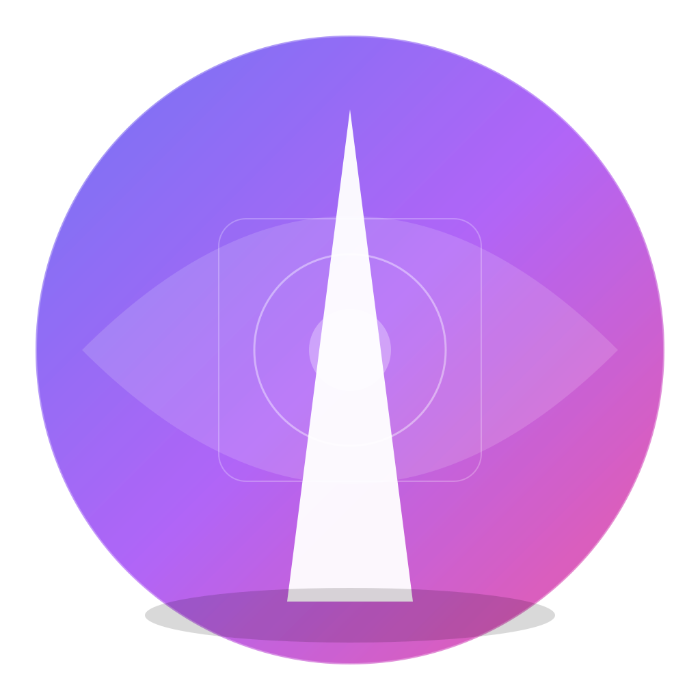
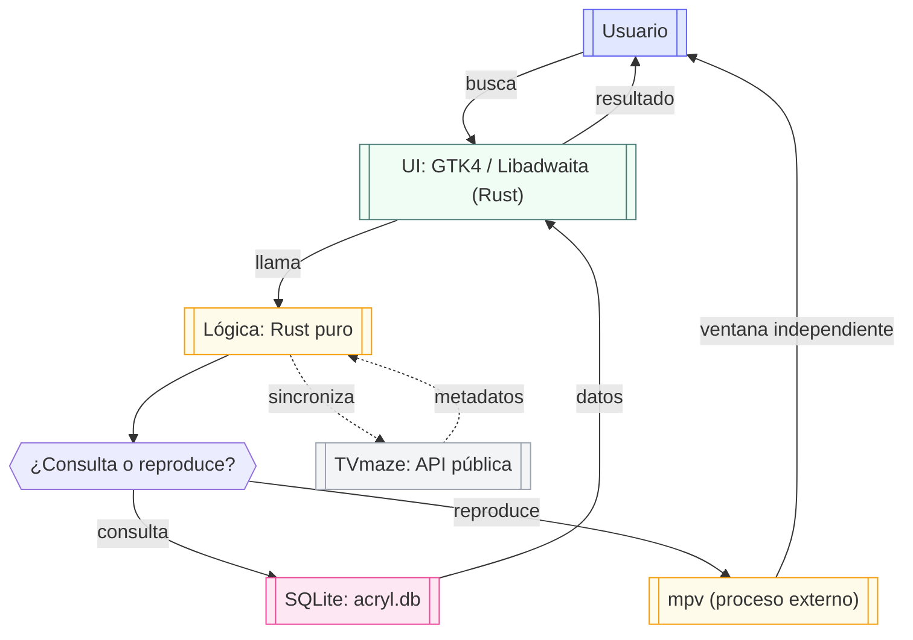

<p align="center">
  
</p>

<h1 align="center">Acryl</h1>

<p align="center">
  <strong>Gestor de contenido multimedia de escritorio para Linux</strong><br/>
  Indexa tu colección de películas, series y anime en una base de datos SQLite local<br/>
  y reproduce tus episodios con mpv, el reproductor de referencia en Linux.
</p>

<p align="center">
  <a href="https://github.com/Angel-p-v/app-media-manager/actions/workflows/ci.yml">
    
  </a>
  <a href="https://github.com/Angel-p-v/app-media-manager/blob/main/LICENSE">
    
  </a>
  <a href="https://www.rust-lang.org/">
    
  </a>
  <a href="https://gtk.org/">
    
  </a>
</p>

---

## 🎯 ¿Qué es Acryl?

**Acryl** es una aplicación de escritorio nativa para Linux que te permite indexar, buscar y reproducir tu colección local de películas, series y anime. La interfaz es Rust + GTK4/Libadwaita y la reproducción se delega a `mpv` en una ventana independiente.

Todo se ejecuta localmente en tu máquina: la base de datos SQLite, el índice de búsqueda de texto completo (FTS5) y la integración con `mpv` mediante `std::process::Command`.

---

## ✨ Características principales

| Capacidad | Descripción |
|-----------|-------------|
| 📚 **Biblioteca local** | Indexa películas, series y anime en una base de datos SQLite con búsqueda FTS5 |
| 🔍 **Búsqueda rápida** | Busca por título con filtrado por tipo y paginación |
| 🖼️ **Pósteres, banners y metadatos** | Descarga pósteres y sinopsis desde TVmaze, banners anchos desde TVmaze/AniList, y los muestra en la biblioteca y en los detalles |
| ⭐ **Favoritos y visto** | Marca contenido como favorito o visto con un solo clic |
| ▶️ **Reproducción con mpv** | Abre el episodio seleccionado en `mpv` (ventana independiente) |
| ⚙️ **Configuración YAML** | Ajustes persistentes en archivo YAML (idioma, ruta de base de datos, reproductor predeterminado) |
| 🌐 **Idiomas** | Interfaz disponible en español e inglés |
| 📦 **Instalación** | Clona el repositorio y ejecuta `./scripts/install.sh` |

---

## 🏗️ Arquitectura

media-manager (Acryl) sigue una arquitectura de capas separadas que garantiza mantenibilidad, pruebas y seguridad:



### Flujo de datos

1. El usuario busca o navega por medios en la UI (GTK4 / Libadwaita, Rust).
2. La UI llama directamente a funciones Rust del backend.
3. El backend consulta **una única base de datos SQLite** (`acryl.db`) y devuelve los resultados a la UI.
4. Para la reproducción, el backend lanza `mpv` como proceso externo (`std::process::Command`) en su propia ventana; `mpv` gestiona play, pausa, seek, volumen y pistas.
5. Los metadatos se sincronizan en segundo plano con TVmaze (API pública, sin API key) para obtener pósteres y sinopsis automáticamente. Para el banner ancho de la vista de detalles se consultan las imágenes `background`/`banner` de TVmaze y, en anime, el banner de AniList (con Kitsu como respaldo). Desde Ajustes se puede forzar una actualización completa que sobrescribe los metadatos de todos los medios indexados.

### Principios de diseño

- **Separación de responsabilidades**: el dominio no depende de la UI; la UI no ejecuta SQL ni accede directamente al sistema de archivos.
- **Inyección de dependencias**: dependencias explícitas, sin singletons globales ni estado mutable innecesario.
- **Contratos tipados**: Serde para serialización interna de Rust, con validación en el límite de entrada.
- **Seguridad por diseño**: mínimo privilegio, sin acceso general al sistema de archivos, sin ejecución de procesos externos arbitrarios, sin WebView.

---

## 📋 Requisitos del sistema

### Dependencias de sistema (Linux)

| Paquete | Propósito | Distribución |
|---------|-----------|--------------|
| `libgtk-4-dev` | Interfaz gráfica (GTK4) | Todas |
| `libadwaita-1-dev` | Componentes de UI (Libadwaita) | Todas |
| `librsvg2-dev` | Renderizado de SVG | Todas |
| `libayatana-appindicator3-dev` | Indicadores de bandeja (opcional) | Todas |
| `mpv` | Reproducción de vídeo (proceso externo) | Todas |
| `libgdk-pixbuf2.0-dev` | Decodificación de imágenes (pósters) | Todas |

> **GTK 4.10 o superior:** Acryl usa el selector nativo de carpetas `GtkFileDialog`,
> disponible a partir de GTK 4.10. Las distribuciones con versiones anteriores
> deberán actualizar GTK para poder compilar y usar la aplicación.

### Herramientas de desarrollo

| Herramienta | Versión mínima |
|-------------|---------------|
| Rust / Cargo | ≥ 1.90 |
| `pkg-config` | Detección de librerías |

---

## 📦 Instalación

### 🚀 Cómo instalar

Acryl no tiene releases publicados. La única forma de instalarlo es clonando
el repositorio y ejecutando el script de instalación:

```bash
git clone https://github.com/Angel-p-v/app-media-manager.git acryl
cd acryl
./scripts/install.sh
```

El script hace lo siguiente:

1. Detecta tu gestor de paquetes (`apt`, `pacman`, `dnf`, `zypper` o `apk`).
2. Instala las dependencias de sistema (`libgtk-4`, `libadwaita-1`, `librsvg2`, `gdk-pixbuf2`, etc.).
3. Instala Rust/Cargo (≥ 1.90) si falta o está desactualizado.
4. Compila la aplicación con `cargo build --release`.
5. Instala el binario en `~/.local/bin/acryl`.
6. Crea la entrada `.desktop` en `~/.local/share/applications/` para que puedas
   buscar y ejecutar Acryl desde el menú de aplicaciones.
7. Instala el lanzador con captura de errores.

Al terminar, busca **Acryl** en el menú de aplicaciones o ejecuta `acryl`.

> **Nota:** el script usa `sudo` para instalar dependencias de sistema. La entrada
> `.desktop` y el icono se instalan a nivel de usuario (`~/.local`), sin necesidad
> de root. **No requiere Node.js ni npm.**

---

### 🗑️ Cómo desinstalar

Si ya no necesitas Acryl, ejecuta el desinstalador:

**Opción A — Ejecutar directamente (sin clonar):**

```bash
curl -fsSL https://raw.githubusercontent.com/Angel-p-v/app-media-manager/main/scripts/uninstall.sh | bash
```

### 🗑️ Cómo desinstalar

Si ya no necesitas Acryl, ejecuta el desinstalador:

**Opción A — Ejecutar directamente (sin clonar):**

```bash
curl -fsSL https://raw.githubusercontent.com/Angel-p-v/app-media-manager/main/scripts/uninstall.sh | bash
```

**Opción B — Clonar el repositorio y ejecutar desde allí:**

```bash
git clone https://github.com/Angel-p-v/app-media-manager.git acryl
cd acryl
./scripts/uninstall.sh
```

El desinstalador elimina:

- La entrada `.desktop` de `~/.local/share/applications`.
- El icono de `~/.local/share/icons/hicolor/scalable/apps/`.
- El binario de `~/.local/bin/acryl` y el lanzador de `~/.local/bin/acryl-launcher`.

**Por defecto no borra** el código fuente clonado ni la base de datos de tu biblioteca (`acril.db`), para que no pierdas tus medios indexados.

#### Borrado absoluto (`--purge`)

Si quieres eliminar absolutamente TODO —incluido el código fuente clonado y la base de datos `acril.db` (tus medios indexados)— usa la opción `--purge`:

```bash
# Opción A
curl -fsSL https://raw.githubusercontent.com/Angel-p-v/app-media-manager/main/scripts/uninstall.sh | bash -s -- --purge

# Opción B
git clone https://github.com/Angel-p-v/app-media-manager.git acryl
cd acryl
./scripts/uninstall.sh --purge
```

> **⚠️ Advertencia:** `--purge` borra tu base de datos `acril.db` y no se puede deshacer. El script pedirá confirmación antes de proceder.

---

### Binario compilado

Una vez compilado, el binario se genera en:

```
target/release/acryl
```

---

### Modo desarrollo

Si quieres ejecutar la aplicación en modo desarrollo (sin instalar):

```bash
git clone https://github.com/Angel-p-v/app-media-manager.git acryl
cd acryl
cargo run
```

---

## 💻 Uso

Una vez iniciada la aplicación:

1. **Indexar medios**: Acryl carga automáticamente los medios desde la base de datos SQLite configurada (`acryl.db` por defecto).
2. **Buscar**: Escribe un título en el campo de búsqueda para filtrar resultados.
3. **Ver detalles**: Haz clic en cualquier medio para ver su banner, sinopsis, año y archivos indexados.
4. **Marcar favorito/visto**: Usa los botones de estado en la vista de detalles.
5. **Reproducir**: Pulsa "▶ Reproducir" en la vista de detalles o en un episodio concreto; el archivo se abrirá en `mpv`.
6. **Actualizar metadatos**: En Ajustes, pulsa "Actualizar todos los metadatos" para volver a consultar TVmaze y sobrescribir título, año, sinopsis, póster y banner de todos los medios indexados. La operación se ejecuta en segundo plano y pide confirmación.
7. **Cambiar idioma**: Usa el selector de idioma en la parte superior de la aplicación.
8. **Gestionar carpetas**: En Ajustes puedes añadir carpetas con el selector nativo
   ("Examinar...") o escribiendo la ruta. Al añadir una carpeta se indexa en segundo
   plano y la galería se actualiza al terminar. "Reindexar todas las carpetas" vuelve
   a escanear las rutas configuradas. Al eliminar una carpeta se pide confirmación y
   solo se borran sus entradas de la biblioteca: **los archivos de vídeo del disco no
   se tocan**.

### Estructura de carpetas e indexado

Acryl detecta automáticamente películas, series y anime a partir de la estructura:

- Los vídeos sueltos en la raíz de una carpeta configurada se indexan como películas.
- Cada subcarpeta se indexa como una serie (o anime si algún componente de la ruta
  se llama `Anime`/`Animes`).
- Las carpetas con un único vídeo cuyo nombre no parece un episodio se indexan como
  película.
- Las carpetas de temporada se detectan con variantes como `S01`, `s01`,
  `Season1`, `Season 1`, `Temporada 1`, `1ª Temporada`, `T2` o con el título
  delante (`Solo Leveling S01`, `Solo Leveling Season 2`), incluso con metadatos
  entre corchetes (`Solo Leveling S01 [1080p]`).
- Las carpetas que solo contienen otras carpetas (`Peliculas/`, `Series/`) se
  recorren como contenedores y no crean un medio propio.
- Los nombres se limpian de resolución, códecs, fuentes, audio y grupos de
  release (`1080p`, `x265`, `H.264`, `BluRay`, `WEB-DL`, `DDP5.1`, `[YTS.MX]`...)
  para obtener títulos correctos y mejorar las búsquedas de metadatos.
- Se omiten los archivos ocultos y los enlaces simbólicos, y se limita la
  profundidad de escaneo para evitar recorridos infinitos.

Reindexar es idempotente y conserva los metadatos ya sincronizados (título, año,
sinopsis, póster y banner).

---

## 📁 Estructura del repositorio

```
app-media-manager/
├── src/                      ← Rust puro (sin Tauri, sin WebView)
│   ├── main.rs               Punto de entrada de la aplicación GTK4
│   ├── core/                 ← Lógica de negocio (library, metadata, player, poster_service)
│   ├── db/                   SQLite, repositorios, migraciones, FTS5
│   ├── config/               Gestión de configuración YAML
│   ├── ui/                   Interfaz GTK4 / Libadwaita
│   │   ├── main_window.rs    Ventana principal
│   │   ├── search_bar.rs     Barra de búsqueda
│   │   ├── media_list.rs     Galería de medios con pósters
│   │   ├── media_details.rs  Vista de detalles
│   │   └── poster.rs         Renderizado de pósters, banners y marcadores
│   ├── Cargo.toml
│   └── Cargo.lock
├── scripts/                  Scripts de instalación y desinstalación
│   ├── install.sh            Instalador automático (sin Node.js)
│   ├── uninstall.sh          Desinstalador
│   ├── diagnose-deep.sh      Diagnóstico profundo Wayland/Hyprland
│   ├── diagnose-final.sh     Diagnóstico final de renderizado
│   ├── fix-blank-screen.sh   Script de solución para pantalla en blanco
│   ├── fix-blank-screen-final.sh Script final de solución
│   └── acryl-launcher.sh     Lanzador con captura de errores
├── PLAN_DESKTOP.md           Plan de migración y hitos del proyecto
├── AGENTS.md                 Instrucciones para el desarrollo
├── CONTRIBUTING.md           Flujo de trabajo y Pull Requests
├── SECURITY.md               Política de seguridad
├── LICENSE                   Licencia MIT
├── README.md                 Este archivo
└── docs/                     Documentación y ADRs
    └── adr/                  Decisiones de arquitectura
```

---

## 🛠️ Comandos disponibles

### Desde la raíz del repositorio

| Comando | Descripción |
|---------|-------------|
| `cargo build` | Compila la aplicación Rust + GTK4 |
| `cargo run` | Ejecuta la aplicación en modo desarrollo |
| `cargo test` | Ejecuta las pruebas de Rust |
| `cargo clippy` | Ejecuta el linter de Rust |
| `cargo fmt` | Aplica formato de Rust |
| `cargo build --release` | Genera el binario nativo Linux optimizado |


---

## 📄 Dependencias y reconocimientos

Acryl utiliza las siguientes dependencias principales. Todas son de código abierto y sus licencias se respetan íntegramente.

### Backend (Rust)

| Crate | Propósito | Licencia |
|-------|-----------|----------|
| `rusqlite` | Bindings a SQLite | MIT |
| `serde` / `serde_json` / `serde_yaml` | Serialización | MIT |
| `reqwest` | Cliente HTTP (TVmaze) | MIT / Apache-2.0 |
| `libc` | Tipos C para FFI | MIT / Apache-2.0 |
| `thiserror` | Errores tipados | MIT |
| `log` | Facade de logging | MIT |
| `pkg-config` | Detección de librerías | MIT |

### UI (GTK4 / Libadwaita)

| Crate | Propósito | Licencia |
|-------|-----------|----------|
| `gtk4` | Interfaz gráfica | LGPL |
| `libadwaita` | Componentes de UI (Libadwaita) | LGPL |
| `gdk-pixbuf` | Renderizado de imágenes (pósters) | LGPL |
| `cairo` | Gráficos 2D | LGPL / MPL |

### Sistema

| Paquete | Propósito | Licencia |
|---------|-----------|----------|
| `gtk4` | Interfaz gráfica | LGPL |
| `mpv` | Reproducción de vídeo externa | GPLv2+ |
| `libgtk-4` | Interfaz gráfica | LGPL |
| `libadwaita-1` | Componentes de UI | LGPL |
| `librsvg2` | Renderizado SVG | LGPL |

> Todas las dependencias de terceros conservan sus licencias originales. Este proyecto se distribuye bajo la licencia **MIT**. Consulta `LICENSE` para más detalles.

---

## 📄 Licencia

[MIT](./LICENSE) © 2026 Angel-p-v

---

## 🤝 Contribución

Consulta [`CONTRIBUTING.md`](./CONTRIBUTING.md) para el flujo de trabajo, convenciones de commits y reglas de calidad.

---

## 🔒 Seguridad

Consulta [`SECURITY.md`](./SECURITY.md) para la política de seguridad y cómo reportar vulnerabilidades.

---

<p align="center">
  <sub>Hecho con ❤️ para gestión de contenido multimedia en Linux.</sub><br/>
  <sub><a href="https://github.com/Angel-p-v/app-media-manager/issues">Reportar bug</a> • <a href="https://github.com/Angel-p-v/app-media-manager/discussions">Preguntar</a> • <a href="https://github.com/Angel-p-v/app-media-manager/blob/main/CONTRIBUTING.md">Contribuir</a></sub>
</p>